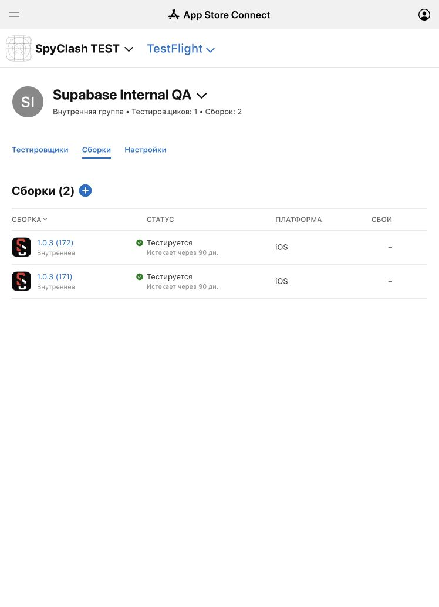

# SpyClash TEST 1.0.3 (172) — internal delivery

Source commit: `e8ca0d9f`, scheme `SpyClash-Supabase-Staging`, Release. Delivery was explicitly approved in this chat for **SpyClash TEST, Internal Only, David Ganzha only**. Production services and the original SpyClash App Store record were not changed.

## Verified delivery

- App Store Connect app: `6822094628`; bundle: `com.spyclash.ios.supabasetest`.
- Main application and embedded `com.spyclash.ios.supabasetest.widgets`: 1.0.3 (172), distribution team `3Z64QKNL54`.
- Both signatures pass strict verification. No fixture credentials or private keys are packaged; the configured backend is isolated project `bbkfsgnordtdiblgdzkg`.
- A test-only widget App ID and App Store profile were registered. The existing main TEST profile was reused. Signed entitlements omit APNs and Sign in with Apple, consistent with those capabilities being disabled in this staging build.
- IPA SHA256: `b6fb9910612aa889d218af473935911f1c6e33da09a3651f6d16c7bdcbd67326`.
- Apple validation and upload succeeded with no errors. Processing finished without warnings or errors.
- Build/delivery ID: `2b5e3eb6-f75d-4408-ba89-705f7b4da257`; server audience: `INTERNAL_ONLY`; processing: `VALID`; internal state: `IN_BETA_TESTING`; external state: `NOT_APPLICABLE`.
- Assigned to `Supabase Internal QA` (`b8c0d934-1061-4795-83b0-3068a7537dee`). Its sole member is David Ganzha. No public link, automatic access group or other individual tester has access to this build.

Read-back was verified at 2026-10-13 01:56 BST. See [delivery evidence](evidence/full-app/build172/testflight-delivery.json) and [independent IPA audit](evidence/full-app/build172/testflight-ipa-audit.json).

## Account and data acceptance

The user normally uses Google and confirmed that the same SpyClash account already has an email/password login. No account password was reset. For this build, sign in with that existing email and SpyClash password; the Google button remains disabled.

Before first real login, the [test-cloud baseline](evidence/full-app/build172/account-import-baseline.json) contains zero linked account reservations, owner imports, imported profiles, packs and history rows. The first verified login should copy the existing profile/SPY ID, owned packs and game history before issuing its Supabase session. Friends and comments are a separate reviewed migration and are not promised by first login.

Physical installation, real-account login and data comparison are pending user acceptance. TestFlight availability is not evidence that those steps have passed. The existing tester-level `INSTALLED` status is not build-specific installation proof.
