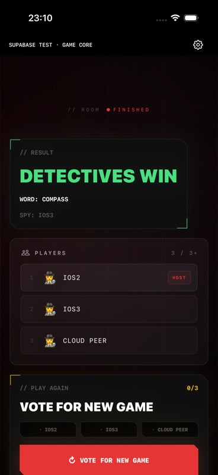
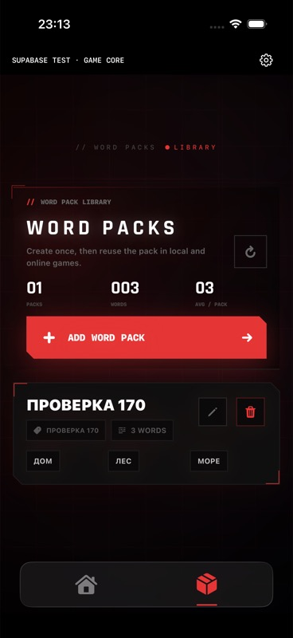

# Full game-core verification — build 170

Date: 2026-10-12. This document records separate implementation, local-test, cloud-deployment and native-test checkpoints. Physical-device and production acceptance remain separate from the verified test environment below.

## Scope and source baseline

The full implementation targets the original SpyClash room protocol and existing gameplay screens. Its source baseline is `568720f1`; a fresh read-only Base44 pull found all 50 deployed TypeScript game-core files byte-equal to that local baseline (`entry.ts` mapped to `main.ts`). The ignored evidence manifest is `.local/canonical-full-core-manifest.json`. Original Base44 game sources were not changed by this extraction.

The separate cloud test project is `spyclash-game-core`, ref `bbkfsgnordtdiblgdzkg`, with canonical origin `https://bbkfsgnordtdiblgdzkg.supabase.co`. Test identities are synthetic. The native target is `SpyClashSupabaseTest`, bundle `com.spyclash.ios.supabasetest`, scheme `SpyClash-Supabase-Test`, build **170**, selected by `SPYCLASH_SUPABASE_TEST`.

The earlier `game_core.sql` RPC backend and standalone `SpyClashGameCoreLab` app remain a separate reduced prototype. Their prior acceptance results do not establish acceptance of this full implementation.

## Architecture actually implemented

1. `handler.ts` accepts the flat original action payload over authenticated HTTP and verifies the bearer token with Supabase Auth. It derives the stable actor from the verified user, rather than trusting client player/host/role fields. Test UI aliases are derived from the authenticated UUID.
2. `service.ts` opens one PostgreSQL transaction through the verified Supavisor transaction pool in cloud (a direct local connection in the isolated harness), acquires a transaction-scoped actor/request lock, and checks the immutable durable receipt. Same actor/request ID plus identical canonical payload returns the original response; different payload rejects reuse.
3. The service locks the selected room row, obtains server time, validates membership/generation/turn context and calls the synchronous `engine.ts` reducer. There is no persisted account-wide Base44 writer lease and no HTTP operation while the room lock is held.
4. The transaction persists room state/revision, active membership, terminal history, outbox records, a metadata-only Realtime signal and the command receipt together. SQL/infrastructure failure aborts the transaction. Definitive business rejection stores a failure receipt without changing game state.
5. `projectGame` uses the original viewer projection. Raw room JSON, secret assignments, private departure tombstones and terminal/outbox internals stay in `full_game_private`. Public signals contain only `room_id`, `revision`, and `updated_at`, protected by membership RLS.
6. Native `SupabaseFullGameStore` journals a frozen request ID and captured fences before sending, distinguishes ambiguous transport failure from definitive rejection, applies monotonic room revisions, and recovers an acknowledged commit through an authoritative read. Realtime triggers reconciliation; periodic snapshot reads cover missed events. Cached private role state is not treated as a newly verified session.

The reducer reuses 25 vendored original rule/projection/stat modules; provenance is in `supabase/functions/full-game-core/rules/README.md`. One port-specific helper change injects entropy into departure turn repair. The server now chooses the exact word and initial roulette/question vector from the validated lobby pool/roster, as authorized for this migration; a client-supplied secret plan is not authoritative. Other retained mechanics are described in [FULL-CORE-PARITY.md](FULL-CORE-PARITY.md).

Closed rooms are retained as tombstones. Explicit departed actors lose active-room and snapshot/signal access while their match participation can remain in retained result history. Eliminated players who have not left remain authorized spectators and eligible for the original replay rules. Rejoining during a match does not undo an ejection.

## Implemented action coverage

This is source and tested-path coverage, not a claim that every permutation has been played through the native UI. The detailed 32-action inventory and baseline line references are in [FULL-CORE-PARITY.md](FULL-CORE-PARITY.md).

| Group | Implemented original actions | Covered behavior |
|---|---|---|
| Discovery and membership | `get_room`, `get_active_room`, `create_room`, `join_room` | Authorized projection, six-character codes, stable identities, concurrent roster updates, 3–12 players and resume. |
| Lobby | `begin_ready_check`, `return_to_waiting`, `toggle_ready`, `kick_player`, `update_game_mode`, `update_game_duration`, `update_lobby_state` | Host permissions, canonical word/settings state, membership/lobby fences, readiness and spy-count/capability reconciliation. |
| Start | `arm_roulette`, `complete_game_start`, `mark_role_card_read` | Frozen server role/word selection, 3-second server intro, one match/start event, timer starts after server card acknowledgements. |
| Questions | `advance_question`, `mark_answer_heard`, `continue_round` | Current-asker permissions, private turn ordering, eight-question results and next-round transition. |
| Associations | `start_association`, `stop_association_spin`, `advance_association` | Speaker order, spin settlement, round advance and roster repair. |
| Clock | `pause_game`, `resume_game`, `finalize_expired_room` | Host pause/resume, floored pause accumulation, server deadline and terminal outcome. |
| Detective voting | `request_vote`, `cast_detective_vote` | `ceil(0.51 × N)` request majority; scoped immutable non-self ballots; **N−S** exclusion; early impossible-candidate cancellation and shared cancellation identity. |
| Guess | `submit_spy_guess` | Active assigned spy only; original comparison and whole-match winner. |
| Replay/return | `vote_play_again`, `reset_room_for_replay`, `return_finished_room_to_lobby`, `vote_return_to_lobby` | Unanimous eligible replay auto-start, committed terminal result, source-match fences and original host-return semantics. |
| Exit | `leave_room`, `close_room` | Lobby host close, pre-card reset, active host transfer/tombstones, turn/vote repair and terminal effects. |

Compatibility `finish_room` is retained with host/server-clock authority. Client result injection through `record_finished_online_game` remains rejected. Adjacent endpoints provide private saved-word-pack CRUD, own history and the original leaderboard response; these are separate from the 32 room actions.

Leaderboard calculation reuses the original single-spy eligibility, logical-result deduplication, rating deltas, tie ordering and top-100 limit. Response IDs are HMAC pseudonyms using private server configuration, with the original `entries` envelope and current-viewer marker. Multi-spy results remain unranked. This does not migrate account-profile mirrors or social rankings stored elsewhere.

## Evidence checkpoint

| Layer | Last completed evidence | What remains pending |
|---|---|---|
| Reducer and leaderboard | **15/15 passed with Deno type checking**: 12 deterministic engine scenarios and 3 original leaderboard/stat/privacy tests. Deno source checks passed. | These tests do not establish HTTP, cloud or native UI behavior on their own. |
| Local Auth/HTTP/PostgreSQL/Realtime | **14/14 passed** against the real isolated stack and the trusted service. | Final local run with the same four-connection per-isolate limit: **14/14**, 47.35 seconds. Cloud separately verifies the deployed transaction pool. |
| Separate cloud full core | Initial version 1 run: **6 groups failed with HTTP 503**, traced to PostgreSQL `53300` (too many connections). Version 2 switched to the Supavisor transaction pool; **6/6 groups passed in 95.885 seconds**, with six clients and no cleanup errors. | This bounded workload fits the existing Free project; production load capacity is not established. [Sanitized cloud evidence](evidence/full-core/cloud-tests.json). |
| Native actual-app target | Build **170**; final XCTest run **14/14 passed**, including immutable room/pack retry and zero Base44 HTTP requests. Normal production scheme also compiles without signing or launch. | Physical installation remains deferred. |
| Native simultaneous full-game clients | Original UI on **two Simulators plus one authenticated JavaScript client** completed a questions-mode match through detective voting. Role acknowledgements, timer, pause/resume, app restart, automatic result and host return to lobby were verified. The test-header overlap was fixed and pause worked through its original control. | Native association-mode and physical radio-fault acceptance remain separate follow-up checks. Cloud fault tests cover the deployed protocol; they are not physical iPhone evidence. |
| Physical iPhone | Deferred for this checkpoint. | Signing, installation, live process, real-screen play and independent-client/network acceptance remain distinct required evidence. |
| Production | No full-core production cutover claimed. | Production migration, rollout and App Store/TestFlight promotion are outside this checkpoint. |

The 14 local integration scenarios are implemented in `tests/full-core/transaction.test.mjs`:

- Auth rejection, private-table denial and membership-scoped signals.
- Concurrent joins/readiness and duplicate immutable commands.
- A response lost after a real commit, another writer, exact receipt replay, and a genuinely unavailable transport.
- Independent-room progress while another room row is held by a separate transaction.
- Injected SQL failure with state/signal/receipt rollback, then exact-request recovery; durable business rejection.
- Complete questions trace, server card clock, pause, result and replay.
- Complete associations turn cycle and N−S ejection.
- Multi-spy privacy plus stale membership and match intents.
- Mode/duration settings, target-membership kick and host lobby exit.
- Concurrent server-deadline finalizers with one result, return and close.
- Nine players/three spies, team visibility, wrong guess and unranked history.
- Departure before the last card acknowledgement resetting the unstarted game.
- Live host departure, host transfer, revoked reads/signals and retained exit receipt.
- Actual WAL signal delivery and recovery after a real socket disconnect.

The 15 deterministic tests include the original candidate-pool rule: spies see candidate words for legitimate guesses, while the exact word is `CLASSIFIED`. They also verify conditional teammate disclosure, terminal disclosure, stale turn revisions, eight-question transitions, cancellation identity, pause boundaries, history/outbox construction and replay. The complete original 55-file helper suite is a reference oracle; this document does not claim that all 55 files were rerun against the extracted implementation.

## Boundaries and incomplete delivery

- **AI generation stays on Base44.** The existing production generator is not migrated or replaced by this work. Synthetic Supabase sessions have no Base44 session, so the test app explicitly blocks generation with `base44_generation_requires_auth`. Manual and saved packs support gameplay testing. Neither a successful Supabase test match nor the visible generator UI proves AI generation acceptance.
- **Outbox delivery is queued only.** A committed `game_started`/`game_finished`/close outbox row proves durable work scheduling. It does not prove external push delivery, Live Activity closure, an outbox worker, APNs configuration or a community-profile mirror update. The terminal certificate refers to queue persistence within the transaction, not recipient delivery.
- **Account services stay separate.** Apple/Google production auth, account migration/deletion, purchases/subscriptions, social/community/profile services, push and Live Activities have not been migrated by this game-core change. Unsupported test-target features remain blocked; synthetic credentials never authorize a Base44 production request.
- **Concurrency tests are bounded fixtures.** Local row-lock independence and retry tests do not prove cloud latency, capacity, regional availability or freedom from every HTTP 409/503. A stale intent can legitimately produce a business conflict; an uncertain transport result must retain its original request ID.
- **Schema and code are separate evidence.** The committed migration, running local schema, cloud deployed function, native source, installed binary and actual device behavior must be identified independently at final handoff.

## Reproduce the local checkpoint

From this directory, with the dedicated local Docker/Colima stack available:

```sh
npm ci
npm run backend:start
npm run full-core:check
npx --no-install deno test --config supabase/functions/full-game-core/deno.json tests/full-core-engine
npm run full-core:test
```

`full-core:test` validates loopback endpoints, applies `supabase/schemas/full_game_core.sql` to the isolated local database, starts the same HTTP handler on `127.0.0.1:56325`, runs real authenticated integration tests and stops its temporary server. It refuses a cloud-linked checkout. Credentials and raw local logs remain ignored under `.local/`.

For the actual native test target, use the shared scheme `SpyClash-Supabase-Test` from the repository Xcode project. Supply synthetic runtime configuration from `Documents/SupabaseTest/config.json`, or `LAB_CONFIG_PATH` on Simulator. The configuration is restricted by the compiled allowlist and accepts only a publishable/anon client key. Do not include service keys in app configuration, command arguments, screenshots or committed evidence.

Cloud tests reproduce with `node scripts/full-core-cloud-test.mjs` after supplying ignored owner-only `.local/cloud-env.json` and `.local/cloud-actors.json`; `--check` validates the exact project and synthetic fixture without game mutations. Physical-device work remains deferred. The legacy `scripts/cloud-test.mjs` and `scripts/native-test.mjs` exercise the reduced RPC/lab protocol and must not be used as full-core acceptance evidence.

## Connection exhaustion found and fixed

The first cloud run exposed PostgreSQL code `53300`: direct connections from separate Edge isolates exhausted the Nano database connection budget. The deployment now uses the transaction pool endpoint verified in this project’s Dashboard (`aws-0-eu-west-1.pooler.supabase.com:6543`), with `prepare: false`, rather than raising the paid plan. The unchanged six-client cloud workload then passed all six groups. This follows the [Supabase connection guidance for serverless functions](https://supabase.com/docs/guides/database/connecting-to-postgres). No paid upgrade was made.

Cloud database audit: **10/10 PASS** for private-table RLS and revoked client access, room/signal revision agreement, active-membership authority, receipt identity/revision, read-only signal grants, Realtime publication and private pseudonym configuration. Security Advisor INFO notices for private tables without policies are intentional deny-all access. The Dashboard-created RLS event-trigger function had unnecessary API execute grants; the test-project migration revokes them. Leaked-password protection remains an existing Auth warning for these synthetic accounts; no paid plan change was made. [Advisor details](https://supabase.com/docs/guides/auth/password-security#password-strength-and-leaked-password-protection).

## Native rendered trace

Room `FZM8CJ` (`ae36ea7a-52e5-4320-b785-74ae1ad47747`), synthetic IOS2 host on Simulator A, IOS3 on B, third client JS6. The host created the room through the original UI; B joined through the native test deep link; four manual fixture words were seeded through the authenticated host API for this match. The host used START NOW, both native users revealed/confirmed their own cards, and the third client acknowledged through the same API. The final card acknowledgement started the server clock. After both apps restarted, they restored the playing room. Host pause/resume worked after the test-only settings header was moved into reserved space. Host and JS6 requested voting and voted for IOS3; the room finished at revision **16**, and native UI showed DETECTIVES WIN automatically. B left through the native UI and A used BACK TO LOBBY.



Snapshots/journals and synthetic configuration remain ignored. Committed screenshots show only disposable test names and the finished test result. Native test binaries were not installed on Ganzha in this task.

## Saved packs through the original native editor

The test dock now exposes the original HOME and PACKS screens. On Simulator B, ENTER MANUALLY created a three-word synthetic pack through the original editor and Supabase CRUD; after app relaunch the library fetched the same saved pack and all three words. This check used UI input, not an API-seeded pack. AI generation explains its retained Base44 authentication requirement; no subscription purchase route is invoked. Pack mutation recovery shares the immutable journal and has its own lost-ack XCTest regression.

Final native XCTest: **14/14 PASS**, result bundle `test_sim_2026-10-12T22-10-44-535Z_pid60230_703c6431.xcresult` (see machine evidence for actual discovered path). Final production scheme unsigned compile: **PASS**, `build_sim_2026-10-12T22-13-50-125Z_pid60230_c57a24e1.log`, without launch or production networking.


